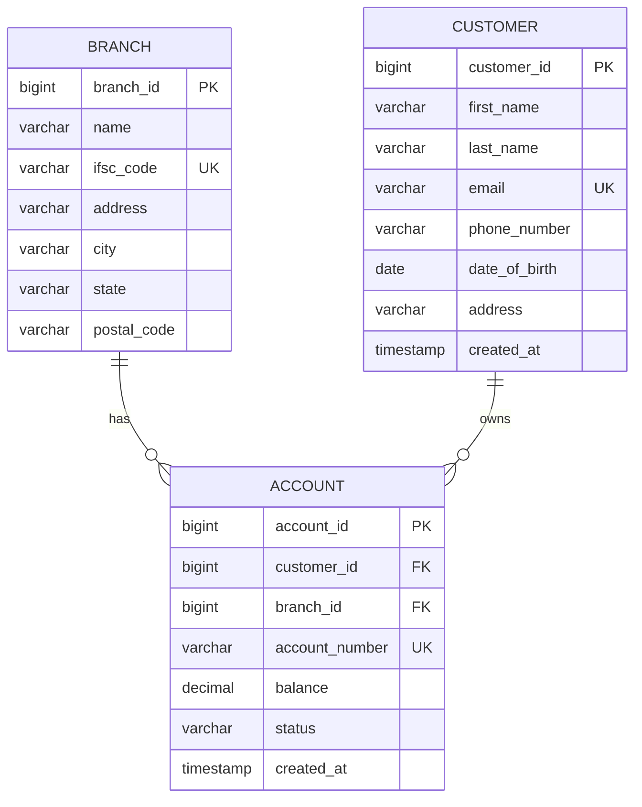

**Constraints**
- chk_account_balance: `balance >= 0`
- chk_account_status: `status is one of ACTIVE, INACTIVE, FROZEN, CLOSED`
- fk_account_customer: `account.customer_id references customer(customer_id)`
- fk_account_branch: `account.branch_id references branch(branch_id)`
- UNIQUE: `branch.ifsc_code, customer.email, account.account_number`
- Defaults: `balance is 0.00, status is ACTIVE, and created_at is CURRENT_TIMESTAMP`