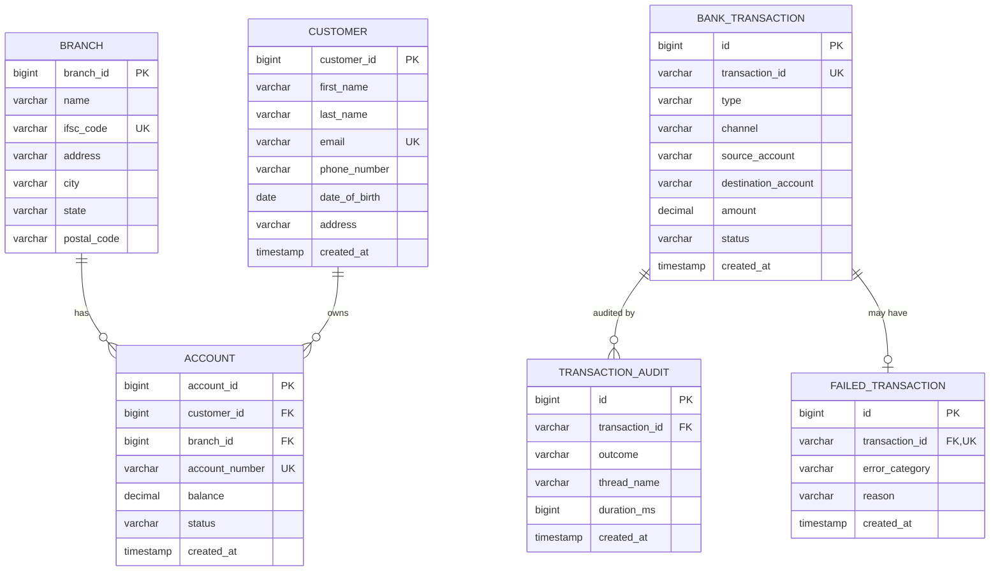

**Constraints**
- chk_account_balance: `balance >= 0`
- chk_account_status: `status is one of ACTIVE, INACTIVE, FROZEN, CLOSED`
- fk_account_customer: `account.customer_id references customer(customer_id)`
- fk_account_branch: `account.branch_id references branch(branch_id)`
- chk_transaction_type: `type is one of DEPOSIT, WITHDRAWAL, TRANSFER`
- chk_transaction_channel: `channel is one of ATM, INTERNET, BRANCH, MOBILE, UPI`
- chk_transaction_status: `status is one of SUCCESS, REJECTED, FAILED`
- chk_audit_outcome: `outcome is one of SUCCESS, REJECTED, FAILED, DUPLICATE`
- chk_audit_duration: `duration_ms >= 0`
- chk_error_category: `category is one of VALIDATION, ACCOUNT_NOT_FOUND, ACCOUNT_NOT_ACTIVE, INSUFFICIENT_BALANCE, SYSTEM_ERROR`
- fk_audit_transaction: `transaction_audit.transaction_id references bank_transaction(transaction_id)`
- fk_failed_transaction: `failed_transaction.transaction_id references bank_transaction(transaction_id)`
- UNIQUE: `branch.ifsc_code, customer.email, account.account_number, bank_transaction.transaction_id, failed_transaction.transaction_id`
- Defaults: `balance is 0.00, status is ACTIVE, and created_at is CURRENT_TIMESTAMP`
